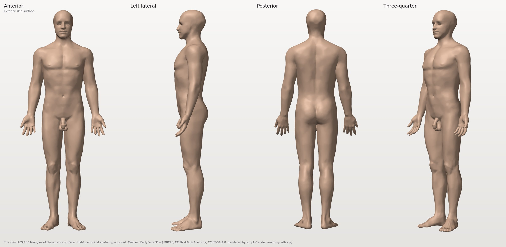
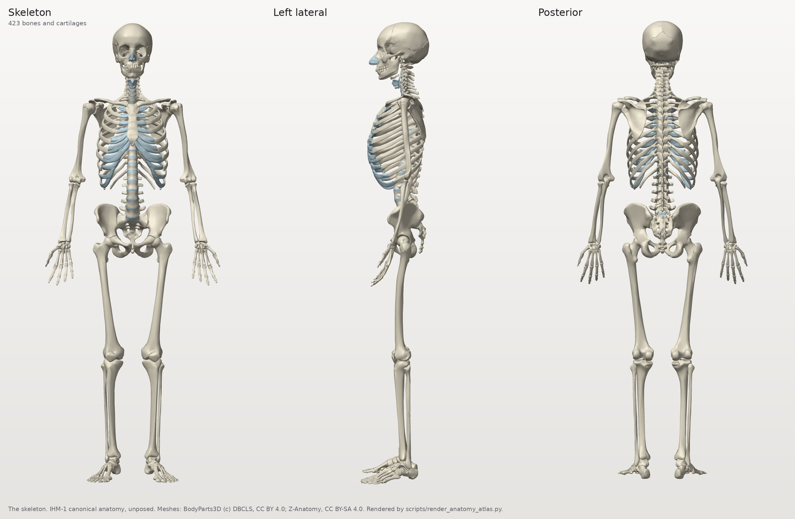
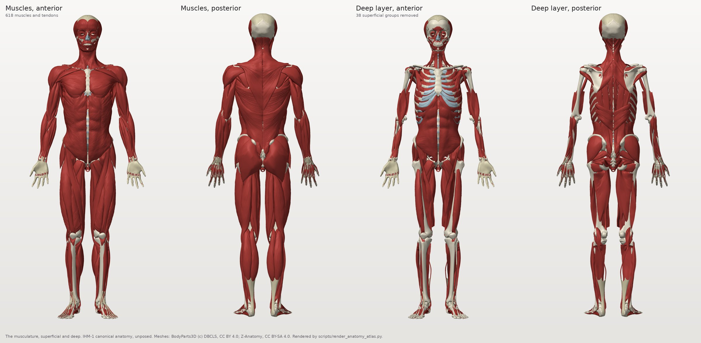
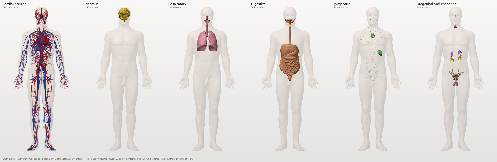
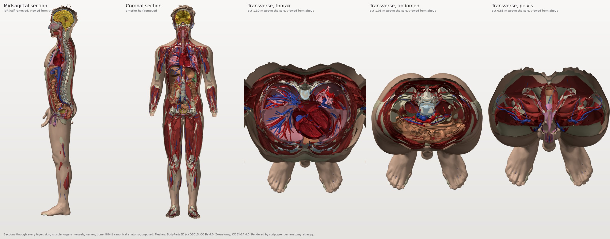
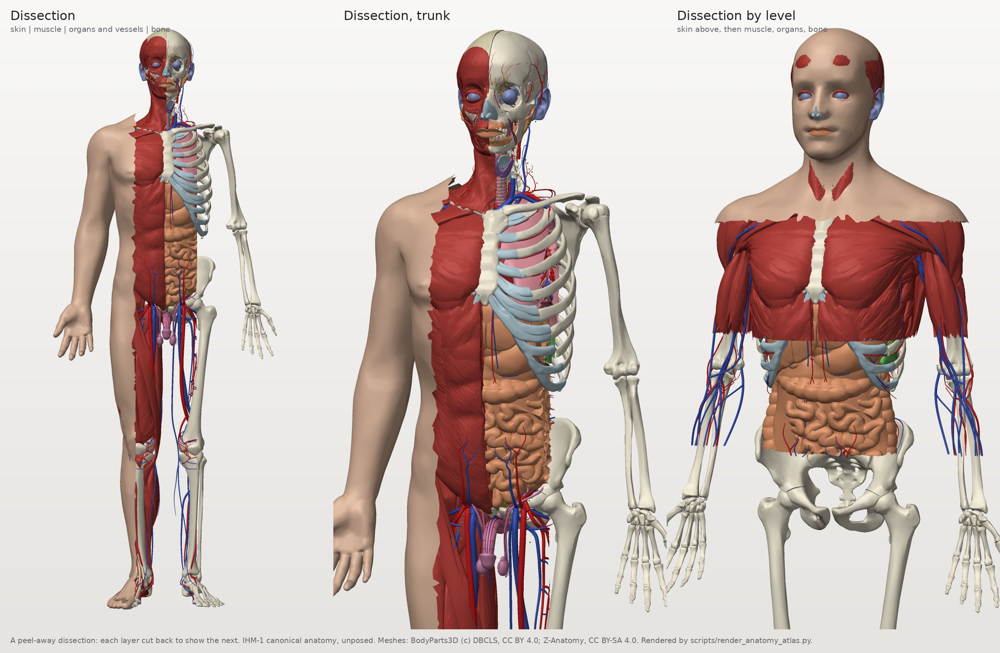
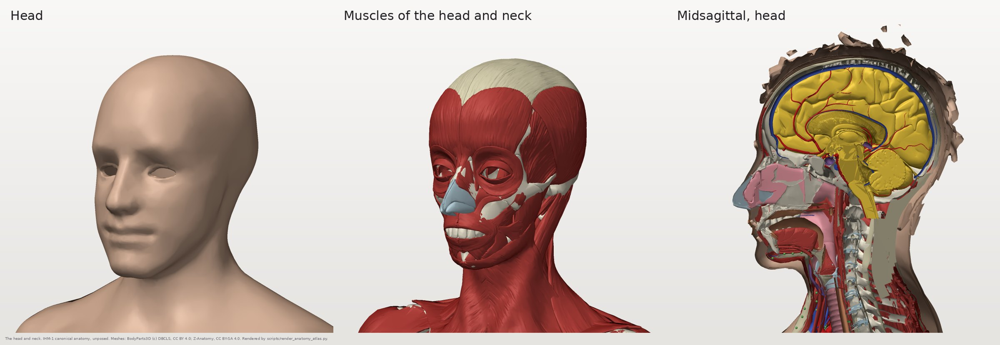
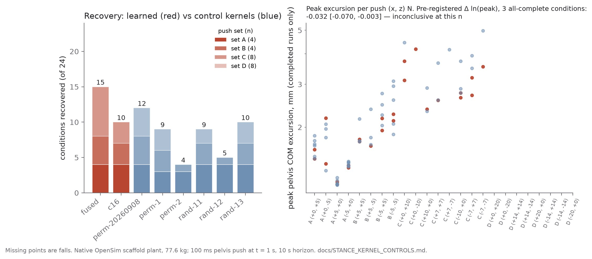
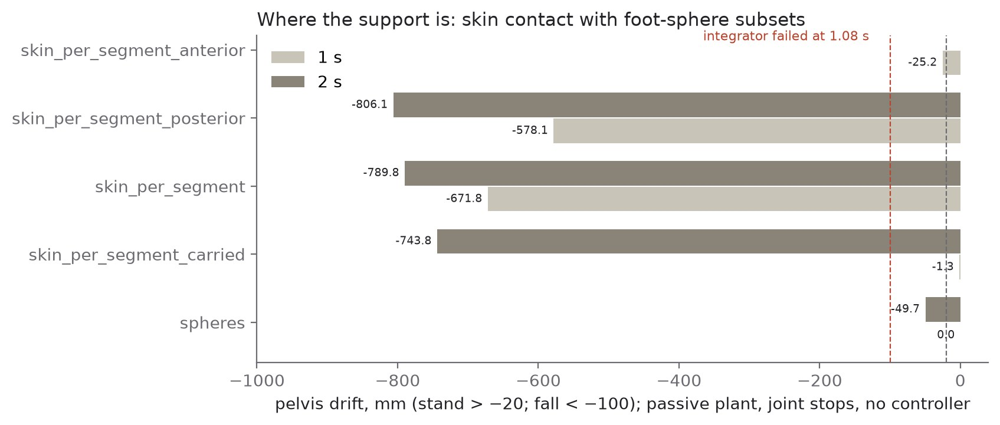

# IHM-1: an auditable two-body human assembly, and what it can and cannot support

*Jacob Valdez. Technical report, October 2026. Repository: IHM-1 (with its brain, IBM-1).*

## Abstract

IHM-1 assembles a human body from acquired sources (two anatomical atlases, a musculoskeletal
model, an integrated physiology engine, and a regional brain model) so that every structure carries
its provenance and its uncertainty, and every predictor is a traced view of shared state rather than
a free-standing model. Its central design fact is that **there are two bodies**: a 4,000-entity
anatomical body (BodyParts3D and Z-Anatomy surfaces, registered into one frame) that is posed
kinematically and feels nothing, and a 22-body, 33-coordinate OpenSim scaffold (98 muscles in the
identified plant) that is the only thing that touches the world. This report states what that
assembly supports and what it does not. It supports a measured, reproducible anatomy (4.67 mm
held-out registration between atlases; 3,995 of 4,000 entities bound to a moving segment, posed to
8e-16 of the engine's own transforms), native physiology on ARM64, and a brain–body loop that
recovers small pushes and falls when severed. It does not support the claim that a learned brain
controls the body: a closing experiment with eight kernels and twenty-four pushes finds the learned
kernels not shown to be better than permuted or random ones, with the spread among controls larger
than any difference the design can resolve. Contact remains the weakest link: on a passive plant no
contact model stands for two seconds, including the one an earlier one-second run read as standing.
We report these negative results as findings, together with the measurement traps that produced
wrong intermediate claims and how each was caught.

## 1. Introduction

A digital human is usually presented as one object: a mesh that moves, a simulator that computes, a
dashboard that reports. Underneath, these are different models with different frames, masses and
statures, glued by code whose assumptions rarely survive inspection. IHM-1 starts from the opposite
end. It is modelled on its sibling brain project, IBM-1: a body is built from four primitives
(fields, anatomy, topologies, processes); each entity carries a source, a licence, and three separate
uncertainty dimensions (biological, registration/synthesis, numerical/display); and any predictor is
a dependency-traced view of the shared state. An unmeasured property never acquires a confidence
merely by being rendered.

The programme question is whether a brain model can control a real anatomical body through its
individual muscles, with "push itself up from prone" as the milestone. This report does not claim
that milestone. It describes the assembly, measures what it currently supports, and records the
places where the running system and the described system diverge.

## 2. The assembly

### 2.1 Two bodies

| | anatomical body | mechanical scaffold |
|---|---|---|
| what it is | 4,000 entities from BodyParts3D + Z-Anatomy, in one metric frame | OpenSim Rajagopal 2016 (22 bodies, 33 coordinates) plus donor paths |
| muscles | 568 muscle surfaces (618 muscles and tendons displayed) | 98 Hill-type actuators in the identified plant (80 leg, 6 lumbar donor, 12 Arm26) |
| mass, stature | 70.7713 kg, 1.7195 m | 77.6122029 kg (BioGears StandardMale, fed), 1.7973 m |
| touches the world | no: posed kinematically | yes: the only thing the engine integrates |

The anatomical body is posed every frame from the scaffold's segments through a binding of 3,995 of
4,000 entities (99.88%); the remaining five are the skin, its three synthesized layers and the lymph
graph, which have their own continuous linear-blend binding. The poser (`ihm/assembly/anatomy_pose.py`)
matches Simbody's own transforms to 7.8e-16 m over 12 frames at 1.3 ms per frame. The two bodies
disagree in mass and stature; both constants are declared once (`ihm/body_constants.py`), the
scaffold's mass is derived exactly (`170 lb × 0.45359237 + 0.5015 kg`, the physiology patient's
stomach seed included), and nerve routes scale by anatomical stature. The displayed anatomy still
scales mechanically: a known, recorded seam.

**The canonical entity count is 4,000** (2,229 BodyParts3D + 1,767 Z-Anatomy + 3 synthesized skin
layers + 1 lymph graph, from `data/derived/canonical/anatomy.json`'s own counts block). Earlier
documents quote 2,403/2,408 (before 1,597 Z-Anatomy display structures were promoted) and 3,816 (no
current artifact reproduces it).

### 2.2 Sources and licences

| source | used for | licence |
|---|---|---|
| BodyParts3D 4.0 (DBCLS) | 2,234 meshes, the skin and skeleton of the canonical frame | CC BY 4.0 |
| Z-Anatomy (rev 702db27) | lungs, lymph nodes, thyroid, display muscles; registered into BP3D | CC BY-SA 4.0 (NC inner-ear and kidney parts excluded) |
| OpenSim models, Rajagopal 2016; Seth 2019 shoulder | the scaffold; the girdle variant | model licences (Seth 2019: CC BY 4.0) |
| BioGears (3f16a5f, built natively on ARM64) | integrated physiology | Apache-2.0 |
| JOS-3 | 85-node thermal model | MIT |
| IBM-1 | 80-region brain, cord, E/I cortex | the sibling project |

Z-Anatomy surfaces were registered into the BodyParts3D frame on 99 bone anchors (affine plus thin-
plate spline) with a **held-out RMS of 4.67 mm**. Z-Anatomy is partly derived from BodyParts3D, so the
two are not independent samples. Non-commercial or no-redistribution sources used for research
elsewhere in the repository (an endometrial MRI set, a knee-cartilage set, a wrist donor) appear in
no figure here.

### 2.3 Physiology, runtime and brain

BioGears owns physiology: a 30 s baseline yields 1,500 native samples and 301 display frames with
finite Laplace and Welch spectra, pinned by SHA-256. Mechanics receives one-way volume ratios (heart,
five lung lobes); the brain receives arterial pressure, saturation and core temperature. The embodied
runtime exchanges physiology every 20 ms and runs the controller every 10 ms; metabolic exchange
passes through a declared τ = 2 s lag, an engineering choice that took sessions from failing on their
second exchange to running about 51. The brain is IBM-1's 80-region model (68 Desikan–Killiany + 12
subcortical; fsaverage→anatomy landmark RMS 15.65 mm, in-sample), joined to the body through 142 of
144 sided nerve routes and 1,326 dermatomal skin patches. Route lengths are modelling hypotheses
(`max(0.03, 1.15 × Euclidean)`), stated as such.

## 3. What it supports

**Anatomy that is measured, not drawn.** Every structure in the figures above is a source surface in
one frame, filtered by licence in the renderer itself (`scripts/render_anatomy_atlas.py`). The skin's
synthesized layers were corrected against physiology: extruding on the raw 3.50 m² area invented
11.4 L of skin (35.9% of body mass); on the 1.78 m² exterior the epidermis-plus-dermis stack weighs
3.13 kg against the ICRP reference 3.3 kg. Twenty-three intervertebral discs mis-typed as rigid bone
are cartilage. Thirty-six of 37 paired bones are exact mirrors; the right femur is not.

**A brain–body loop that is load-bearing.** A 1,024-site IBM E/I cortex, trained against an
engineered stance teacher, holds a 77.6 kg scaffold against 100 ms, 5 N pelvis pushes for 10 s (peak
excursion 1.78 mm on (+5, +5) N) and falls when the cortex is severed (2.9 s). In this report's
closing experiment the learned kernels recovered 15/24 and 10/24 push conditions, while severed arms
always fall. Something in the loop is doing work.

**Reproducibility across hosts.** On a second machine the stance pipeline reproduces the earlier
numbers to the printed digit (1.7469 and 1.7452 mm), a rebuilt control policy reproduces its
original, and the thoracic-reassignability register (44 torso-attached muscles, 10 reassignable,
verdict UNBLOCKED) is rewritten identically.

## 4. What it does not support

### 4.1 The learned kernel is not shown to matter

An earlier result compared one learned kernel with one row-permuted kernel on one push and found them
equal (1.7469 vs 1.7452 mm), read as "the dynamics are load-bearing, the learning is not shown". We
pre-registered the control that was missing (`docs/STANCE_KERNEL_CONTROLS.md`): two learned kernels,
three row-permuted and three random kernels at matched per-site norms, one identical pipeline, and 24
pushes from 5 N to 20 N in eight directions.

| outcome | value |
|---|---|
| conditions where all eight arms completed 10 s | 3 of 24 |
| mean Δ ln(peak), learned − controls, over those 3 | **−0.032**, 95% CI [−0.070, −0.003] |
| pre-registered verdict | **inconclusive at this n** |
| median spread among the six controls | 0.071 (wider than the 5% margin) |
| recoveries, learned | 15, 10 |
| recoveries, controls | 12, 9, 4, 9, 5, 10 |
| "learned recover more than every control" | **no** (10 < 12) |

The n = 1 comparison drew a strong control: on its own push, three of the six controls fall (to 162,
373 and 524 mm) while both learned kernels hold. So neither reading survives. Kernel content changes
whether this pipeline recovers, but the variation among destroyed kernels is as large as anything
separating them from the learned ones. The design cannot resolve a 5% effect, and no kernel recovers
any 20 N push. The decoder is solved offline onto an engineered LQR gain; equivalence here would
mean *this pipeline does not use kernel content*, not that no pipeline could.

### 4.2 Contact: nothing stands passively

Replacing the source foot spheres with per-segment skin contact made the body fall 672 mm within 1 s,
and every skin vertex reaching the floor sat behind the centre of mass. The same geometry with all 12
spheres kept read as standing (−1.3 mm at 1 s). We pre-registered a test of *where* the support must
be (`docs/SKIN_STANCE_SUPPORT.md`): keep only the four posterior or only the eight anterior spheres,
run 1 s and 2 s.

At 2 s, **every skin arm falls, including the reference**: the carried arm is 744 mm down, the
posterior subset 806 mm, the anterior subset's integrator fails at 1.08 s, and even the source
spheres with no skin sag 50 mm. By the pre-registered table neither subset suffices, but the more
important finding is that the one-second "stand" was a transient. On a passive plant the question
"which contact model stands?" has no positive answer; contact models must be compared under a
controller, or by time-to-fall.

### 4.3 The runtime stops early

The live upright embodied body fails its integrator at t = 1.026 s. One 10 ms `advance()` cost
0.112 s, then 24.3 s at 1.82 s, and did not return after 22 min at 1.83 s, when 26 unconnected
actuator ports left the arms a rag doll and a muscle left the force–velocity domain. Holding the ports
restores 0.124 s per advance; that run then ends on pelvis tilt at 1.49 s. A supine session fails its
metabolic budget check (−10.43 W against 10.37 W allowed) on a single-sample reference. The re-base
of that reference landed, but its effect on supine duration is unmeasured. On a second host the
supine session could not be run at all, because the controller reads IBM-1 source at run time and no
available IBM-1 revision matches the checkpoint (§6).

### 4.4 Other limits

- **Joint ranges are declared but not enforced** by OpenSim during forward dynamics; a search found a
  973 mm prone "crawl" with the ankles 95° past range (withdrawn). Of 67 stored crawl trajectories,
  none stays inside its declared ranges; the best (0.920 m in 16 s) breaks them on 12 of 22
  coordinates.
- **The ankle collapse of the spine variant** rides on the trunk mass repartition (+1.254 rad), and
  the inertia-inscribed contact proxy is sufficient on its own to produce it. Two mechanisms proposed
  after the factorial were each excluded by an instrument built for them.
- **A contact law fitted to the soft layer** reproduces the engine to 2.7e-15 and fits the heel to
  about 5%, but is 7.7× too stiff on the forearm; one stiffness does not transfer across segments.
- **Brain → body coupling is thin in places**: the cortico-cortical path carries 0.03–0.07% of the
  signal, and an EMG recruitment test failed its first prediction.
- **No fatigue law**: the physiology engine exposes no phosphocreatine or pH.

## 5. How the wrong intermediate claims were caught

The repository keeps a ledger of claims that were stated, then measured to be wrong. Several are
general enough to report:

- **A short run cannot tell settling from falling.** Twenty-five steps read a fall as a repair; 1 s
  read a transient as a stand (§4.2). Run long enough for the failure mode to appear, and say how long.
- **A factorial identifies a factor, not a mechanism.** Mechanisms attributed afterwards needed their
  own instruments, and the first two guesses were wrong.
- **A borrowed constant in a pre-registration is still an assumption.** A 10% correspondence trim
  adopted by analogy cost 22% of recovery accuracy.
- **A sum over repeated events cannot tell drift from a rejected jump.** A "143 mm drift" was one
  47.8 mm teleport refused three times.
- **A denominator read off a directory listing is not the denominator.** "Of 102" was "of 91".
- **A control that cannot fail has not passed.** A gate passed while running in the wrong mode, read
  back only from the flag. Read the mode out of the run's own output.

## 6. Reproducing this report

Results: `out/stance_kernel_controls.json`, `out/skin_stance_support_{100,200}.json`,
`out/thoracic_reassignability.json`. Figures: `scripts/render_anatomy_atlas.py`
(→ `docs/figures/atlas/`) and `scripts/plot_paper_figures.py` (→ `docs/figures/results/`).
`docs/JOURNAL.md` records the second-host runs, including two traps for anyone repeating them:
IBM-1's checkpoints and raw payloads may be symlinks to removable storage (copy them, don't rsync the
links), and the IBM controller executes IBM-1 *source* at run time. A run is therefore a function of
the IBM-1 checkout as well as of the checkpoint, and the supine session in §4.3 could not be
reproduced because the matching IBM-1 working tree no longer exists. Pinning that checkout by hash
next to every embodied result is the first fix this report recommends.

## Acknowledgements and attributions

Anatomical surfaces: **BodyParts3D, © The Database Center for Life Science, licensed under CC
Attribution 4.0 International**; **Z-Anatomy** (github.com/Z-Anatomy), CC BY-SA 4.0. Figures derived
from Z-Anatomy surfaces are shared under CC BY-SA 4.0. Musculoskeletal models: OpenSim (Rajagopal et
al. 2016; Seth et al. 2019, CC BY 4.0). Physiology: BioGears (Apache-2.0). Thermal: JOS-3 (MIT).
Nothing in this report is a claim about a biological brain or a clinical body.
